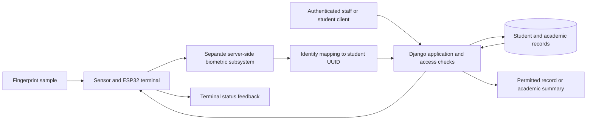

# Report planning guide: theoretical framework and methodology

Prepared on 12 October 2026 from the current project files. Scope: the complete student-records system, fingerprint terminal, and enclosure. This is a proposed report structure, with sample wording and a planned evaluation; it is not a statement that pending experiments have been performed.

Suggested working title: **Design and Development of a Fingerprint-Assisted Student Records and Identification System for the Department of Electrical and Electronic Engineering, Obafemi Awolowo University**. Use the approved project title in the submitted report.

## 1. The central idea of the report

Present the project as an integrated engineering system that links a student's biometric identity to a stable departmental record and supports authorised academic-record processing. Its contribution lies in designing and evaluating the hardware, software, and communication that make this workflow possible.

The two chapters answer different questions:

- **Theoretical framework:** Which principles explain the system's operation and justify its design?
- **Methodology:** How are those principles translated into requirements, hardware, software, integration, and measurable tests?

Keep the link explicit: fingerprint pattern matching explains identity recognition; relational data principles explain consistent records; access-control principles explain permitted retrieval; embedded and distributed-system principles explain capture, communication, and failure handling.

A successful fingerprint match establishes an identity outcome. Staff authentication and permission checks still determine whether the associated record may be viewed or changed.

### What the files currently support

| Area | Evidence in the workspace | How to describe it in the report |
| --- | --- | --- |
| Student records and accounts | Active Django models, routes, services, and tests for profiles, guardians, sessions, adviser scope, and messaging | Backend implementation exists; report the particular functions actually demonstrated |
| Academic processing | Result entry/correction/verification, grading versions, GPA/CGPA calculations, HOD completeness review, and controlled exports | Explain the implemented rules and distinguish them from institutional approval of those rules |
| Result extraction | PDF table/student parser and CSV/JSON outputs | A layout-specific extraction component exists; complete staged backend import remains pending |
| Frontend | Standalone browser prototypes with local demo state | Interface prototype; a connected production React client is not established by these files |
| Database | Django models/migrations, PostgreSQL preparation, isolated test settings | PostgreSQL is the intended application database; live source reconciliation and cutover remain pending |
| Fingerprint terminal | Architecture and API proposals; external firmware review | Physical capture, compatible server matching, enrolment, and terminal API integration remain pending |
| Enclosure | Revision-B CAD, drawings, parameters, and geometry-validation output | Digital enclosure design exists; real component fit and fabrication are unverified |
| Audit and operation | Planned audit, deployment, backup, and recovery work | Describe as planned unless corresponding implementation and test evidence are added |

Some older README/handoff passages describe features as pending that later backend documents describe as implemented. Use current code and the latest feature documents when writing the final report.

## 2. Suggested structure for the theoretical framework

Place this material in Chapter Two after relevant background and the review of related systems, unless the department specifies a separate chapter. Use the numbering below as a guide, not as a prescribed institutional format.

### 2.x.1 Introduction to the framework

Introduce the four main foundations: biometric recognition, embedded/client-server architecture, relational data integrity, and access control. Then identify academic calculation and reliable communication as principles applied within those foundations.

Suggested opening:

> The proposed system is grounded in biometric pattern recognition, relational data management, and controlled access to information. A fingerprint terminal acquires biometric samples for identity resolution by a separate server-side subsystem, while the departmental application manages student profiles and academic records. These components are connected through an authenticated communication interface. The framework therefore explains both how a student is identified and how the resulting identity is used within an authorised records workflow.

### 2.x.2 Biometric recognition and fingerprint pattern matching

**Explain:** acquisition, enrolment, feature representation/template generation, comparison, a decision threshold, and the mapping from a biometric identity to a student UUID. Ridge endings and bifurcations are examples of minutiae used in fingerprint representations; the representation used by this project must be established from the actual sensor/matcher. NIST's [MINEX work](https://www.nist.gov/itl/iad/image-group/minex04-homepage) provides a technical starting point for template generation and interoperability.

Distinguish the operating modes:

- **Verification (1:1):** a person claims an identity and a new reading is compared with that identity's enrolled reference.
- **Identification (1:N):** a reading is searched against an enrolled gallery to resolve an identity.

These modes have different evaluation measures; see NIST's [explanation of biometric errors](https://www.nist.gov/blogs/taking-measure/tale-two-errors-measuring-biometric-algorithms). For the proposed scan-to-record workflow, use 1:N identification as the working assumption unless the final interface first selects a claimed student.

For a matcher whose larger scores mean greater similarity, the conceptual rule is:

\[
\operatorname{candidate} = \arg\max_j S(T_p,T_j)
\]

\[
\operatorname{accept\ candidate}\quad\text{if}\quad S(T_p,T_{\operatorname{candidate}})\geq\tau
\]

Here, \(T_p\) is the probe representation, \(T_j\) is an enrolled reference, and \(\tau\) is the decision threshold. The selected matcher may add quality checks, ambiguity rejection, or different score semantics; document those actual rules. A similarity score is not automatically a probability of correctness.

**Apply to this project:** the terminal captures the sample; the separate biometric subsystem performs the agreed matching; an active mapping resolves the biometric identity to the student's stable UUID. Biometric material should have its own controlled storage design rather than being casually added to academic tables.

**Report evidence:** enrolment and scan flowcharts, the actual sample/template format, matcher name/version, threshold choice, identity-mapping design, and a clearly defined error experiment.

Use the [fingerprint score and evaluation reference](fingerprint-score-and-evaluation-reference.md)
for the assembled terminal's score interpretation, trial fields and reporting metrics.
The [portable template design](fingerprint-template-storage.md) defines the proposed
enrollment record and the export/restore compatibility experiment.

Do not claim that the team implemented image enhancement, thinning, minutiae extraction, or presentation-attack detection unless those operations are actually implemented and evaluated. Explain library or sensor functions as supplied components where appropriate.

### 2.x.3 Embedded systems and client-server architecture

**Explain:** the terminal is an embedded capture/feedback node, the backend coordinates application requests, and persistent records belong to server-controlled storage. Espressif documents [ESP32 communication interfaces and Wi-Fi capability](https://www.espressif.com/en/products/socs/esp32/technical-resources); cite the datasheet for the exact board/module ultimately used.

**Apply to this project:** the ESP32 communicates with the fingerprint sensor through the confirmed interface, gives prompts through the display/indicators, and exchanges protected requests with the server. The browser is another client. Both use backend services rather than direct database access.

Discuss UART and I2C only to explain their actual roles. The current enclosure anticipates an OLED, sensor, DS3231, buttons, LEDs, and buzzer; their final models, pin assignments, and operating conditions remain to be confirmed.

**Report evidence:** overall block diagram, circuit schematic, pin/interface table, firmware state diagram, network request sequence, and photographs of the assembled terminal when available.

### 2.x.4 Relational data management and integrity

**Explain:** entities, keys, relationships, appropriate decomposition of tables, uniqueness, referential integrity, and transactions. Codd's [relational-model paper](https://doi.org/10.1145/362384.362685) is a foundational reference; PostgreSQL's [constraint documentation](https://www.postgresql.org/docs/current/ddl-constraints.html) connects the principles to implementation.

**Apply to this project:** a permanent student UUID identifies a record independently of a change from UTME to matriculation identifier. Results reference students and course offerings; offerings preserve session/semester context. Guardians and login accounts are distinct relationships. Result attempts and historical credit units/grading versions preserve the meaning of earlier calculations.

Explain why text identifiers preserve leading zeros, why duplicate attempts must be rejected, and why a missing score differs from a recorded zero. Describe atomic updates where partial completion would leave inconsistent records.

**Report evidence:** entity-relationship diagram, data dictionary, constraints table, import-validation rules, and tests of duplicates, invalid references, and rollback. Do not claim a particular normal form without analysing the actual schema and its functional dependencies.

### 2.x.5 Role-based permissions and record scope

**Explain:** users, roles, permissions, operations, and protected resources. [NIST IR 6192](https://csrc.nist.gov/pubs/ir/6192/final) provides a formal RBAC foundation.

**Apply to this project:** use RBAC as the base, with additional restrictions based on adviser assignment, academic session, student level, and ownership of a student account. Calling the whole policy simply RBAC would omit these contextual restrictions.

For an ordinary adviser, a simplified project rule is:

\[
\operatorname{allow}(u,a,r)=
\operatorname{authenticated}(u)\land
\operatorname{hasPermission}(u,a)\land
\operatorname{inAssignedScope}(u,r)
\]

Describe HOD access and student-own-record access separately. The biometric result is an identity input to the workflow; it does not replace the logged-in user's permissions.

**Report evidence:** role/action matrix and direct API tests for authorised access, another student's record, an out-of-scope adviser, revoked permissions, and exports.

### 2.x.6 Academic calculation and record completeness

**Explain:** GPA and CGPA are credit-weighted averages, with their meaning dependent on the results included and the grading policy applied.

\[
\operatorname{GPA}=\frac{\sum_{i=1}^{n}u_i g_i}{\sum_{i=1}^{n}u_i}
\]

CGPA uses the same expression over the relevant cumulative set. Here, \(u_i\) is saved credit units and \(g_i\) is the grade point produced by the result's grading version.

**Apply to this project:** the implemented calculation includes recorded failed and repeated attempts, returns no value when no results exist, and blocks calculation when supplied results are missing scores or unverified. Academic completeness is a separate HOD-reviewed decision. The numeric CGPA alone does not establish satisfaction of all graduation requirements.

Use the current scale and repeat policy as the implemented project rules. Obtain the department's authoritative policy before presenting them as official OAU requirements.

**Report evidence:** worked manual examples and software comparisons, grade-boundary cases, repeated attempts, missing values, historical grading changes, and stale-review rejection.

### 2.x.7 Reliable communication and hardware operation

**Explain:** requests and responses can be delayed, lost, repeated, or interrupted. The proposed design uses explicit request/event identifiers, authenticated devices, expiry, bounded retries, and deduplication. A retry should preserve the original event identity so that one operation is not applied twice.

**Apply to this project:** distinguish match, no match, poor capture, transport failure, and server failure in terminal feedback. Use server-controlled freshness checks. An RTC may support local timestamps, but its timestamp alone should not establish that a request is fresh or authorised.

Connect power and mechanical choices to reliable operation. A useful sizing expression is:

\[
P_{\mathrm{load}}=\sum_k V_k I_k,\qquad
t_{\mathrm{estimate}}=\frac{E_{\mathrm{usable}}\eta}{P_{\mathrm{average}}}
\]

Use watts and watt-hours consistently. Define whether \(E_{\mathrm{usable}}\) is energy before conversion, so that conversion efficiency \(\eta\) is not counted twice. Validate the estimate using measured terminal loads and runtime.

**Report evidence:** power budget, measured rail voltage/current, reboot/reconnect behaviour, duplicate-event tests, enclosure measurements, and component-fit checks.

### 2.x.8 Conceptual framework and synthesis

Include one diagram showing how the principles work together:

This diagram shows the intended logical responsibilities; it does not establish implemented endpoints or decide whether the matcher runs in the same process as Django.

Explain the expected outcomes as evaluation questions: can the system resolve identities correctly, preserve academic information, restrict access appropriately, and complete workflows within measured time? Present improvement over a manual process only if an equivalent baseline is measured.

## 3. Suggested structure for Chapter Three: methodology

### 3.1 Research and development approach

Use **engineering design and development with iterative prototyping and experimental evaluation**. This fits a project whose principal output is a working hardware/software artefact.

Describe the process as: requirements definition, architecture, component feasibility, detailed design, subsystem implementation, integration, evaluation, and refinement. State which stages have been completed and which remain planned.

Suggested opening:

> The project adopts an engineering design and development approach to produce an integrated fingerprint-assisted student-records system. Development is organised around requirements analysis, hardware and software design, subsystem prototyping, integration, and experimental evaluation. The records application and terminal are initially evaluated separately, after which their combined identity-to-record workflow is tested. Quantitative evaluation covers recognition outcomes, response time, record-processing correctness, access restrictions, and terminal operation under selected failure conditions.

Use past tense only for work actually performed. Do not describe stakeholder interviews, fabrication, field trials, or deployment as completed without evidence.

### 3.2 Study context, requirements, and scope

Describe the department, intended users, records workflow, and the specific identification task. Explain how requirements were obtained: team requirements already recorded, document analysis actually performed, and any stakeholder consultation subsequently conducted. Record dates and participants for consultations when they happen.

Define the core functions: maintain student profiles and academic records; enrol and identify students; connect a recognised identity to a record; calculate reviewed academic summaries; and enforce staff/student access rules.

Identify nonfunctional requirements with measurable criteria: recognition performance, latency, retry behaviour, data integrity, access isolation, and physical usability. Agree numerical performance targets before the final experiment and record their rationale.

Messaging, guardian sharing, and reviewed graduation can be described as supporting backend functions. Additional prototype screens, such as timetables and resource workflows, should enter the reported scope only if selected and implemented. Attendance recording requires a separate agreed requirement.

Suggested artefacts: requirements table, use-case diagram, and role/action matrix.

### 3.3 Overall system architecture

Describe the terminal, communication interface, biometric service, Django application, user interface, and intended PostgreSQL storage. Show enrolment and identification as separate sequences.

For enrolment: authorised operator selects an existing student, captures the required samples, creates a compatible enrolled reference, binds it to the UUID, and confirms success. For identification: the server creates an authorised request, the terminal captures a new sample, the biometric subsystem matches it, the identity mapping is checked, and the application provides only the outcome/records allowed for the requesting user.

**Architecture decision to resolve before implementation:** the later biometric review calls for server-side matching, while an older API cheat sheet describes device-reported matched outcomes. The final contract must reflect the selected architecture. For server-side matching, a device slot number or device assertion of a match is insufficient; the server matcher needs a compatible sample/representation.

Define failure paths as well as the successful path: no usable sample, no match, inactive mapping, unauthorised/revoked device, expired request, repeated event, and network/server failure.

### 3.4 Materials, components, and selection criteria

Provide a bill of materials with exact model, quantity, function, electrical requirements, interface, and reason for selection. The present design anticipates:

| Item | Intended function | Information still needed for the final report |
| --- | --- | --- |
| ESP32 board | Capture coordination, networking, and feedback | Exact module/board, pinout, supply, firmware toolchain |
| R307 or AS608 sensor | Fingerprint acquisition | Selected model/revision, export commands, sample format, electrical levels, measured dimensions |
| 128 × 64 I2C OLED | Operator prompts and scan status | Exact display/controller, dimensions, address, supply |
| DS3231, if retained | Local timekeeping | Purpose, wiring, backup supply, timestamp use |
| Buttons, LEDs, buzzer | User commands and feedback | Defined button actions, ratings, resistor/driver requirements |
| Regulated external/battery power | Stable operating rails | Battery/holder, regulator, protection/charging arrangement, measured load |
| Veroboard/PCB, connectors, enclosure | Assembly and protection | Final mounting, cable routing, fabrication material, fit measurements |
| Server and development tools | Matching, application, storage, and tests | CPU/RAM/OS, matcher version, package versions, database version, network setup |

Do not assign one voltage specification to all R307/AS608 variants. For example, the [RAK12001 documentation](https://docs.rakwireless.com/product-categories/wisblock/rak12001/datasheet/) describes a carrier with a boost converter; it is not the datasheet for every bare sensor bearing an R307 label.

### 3.5 Sensor and server-matcher feasibility experiment

Make this the first hardware gate because it determines whether the intended architecture can be built with the selected components.

1. Identify the exact sensor and obtain its command/protocol documentation.
2. Capture and export the image or supported representation through the actual ESP32 interface.
3. Confirm that the chosen server matcher can read that representation; a proprietary template is not automatically interoperable.
4. Enrol a reference and compare a separately captured reading from the same finger.
5. Compare a reading from a different finger and record the matcher output.
6. Record payload size, export time, matcher version, score semantics, and error handling.

The gate passes when the real sensor-to-server path supports reproducible comparison with documented formats. A failure requires a recorded component/architecture revision before claiming server-side matching. Successful mocked API calls do not prove this gate.

### 3.6 Hardware, circuit, and enclosure design

Provide the actual schematic and a wiring table showing MCU pin, connected component pin, interface, voltage/logic assumptions, and any protection or level conversion. Confirm compatibility from the exact parts used.

Explain power sizing for idle, acquisition, Wi-Fi transmission, display/buzzer operation, and peak demand. Measure supply behaviour during these modes rather than relying only on nominal consumption figures.

Describe sensor access, screen readability, button placement, board retention, cable bends, ventilation, power entry, battery access, and maintenance access. The revision-B CAD draft is approximately 193 × 102 × 100 mm overall with nominal 3.2 mm walls. These are design parameters, not dimensions measured from an assembled product.

Describe CAD solid/interference checks separately from physical fit tests. Fabrication material, printer/process settings, fasteners, and measured deviations belong here once established.

### 3.7 Firmware and biometric workflow

Explain the terminal as a state machine: start-up, device authentication/connection, idle, request received, acquisition, submission, waiting, outcome display, and bounded recovery. Show enrolment states separately if enrolment is initiated from the terminal.

Describe actual sensor-library operations and failure codes. Document timeout limits, retry limits, retained event identifiers, and behaviour after a restart or connectivity loss. Specify how credentials are provisioned and revoked.

For server matching, describe enrolment reference generation, storage controls, gallery lookup, thresholding, identity binding, and deletion/update behaviour. State whether matching is a library, external service, or team-developed algorithm.

### 3.8 Software and database implementation

Describe Django/DRF modules, the interface actually used for evaluation, intended PostgreSQL deployment, and authentication/permission enforcement. Include an ER diagram and data dictionary for student, guardian, user, adviser assignment, session, course offering, grading scale, result attempt, and completeness review.

Explain the UUID-to-biometric mapping as a proposed identity relationship until implemented. The ESP32 should interact through the agreed API and should not receive database credentials.

Describe GPA/CGPA calculation, saved units and grading versions, repeated attempts, score verification, corrections, and HOD review. Include a small hand-calculated example with the same inputs used in a software test.

### 3.9 Data extraction, validation, and import procedure

Describe PDF extraction as an adapter from source documents into reviewed structured records. The current parser supports a particular marks-sheet layout, carries source page/table information, preserves ambiguous codes, and does not recalculate the source-reported GPA.

Distinguish source-reported summaries from backend-derived summaries. They may differ because of incomplete history or policy differences; compare them only when their inputs and definitions are aligned.

Explain the planned backend sequence: extract, validate, preview errors/conflicts, review, then commit atomically. Cover identity resolution, leading-zero identifiers, course/session matching, missing scores, duplicate attempts, and safe re-import. Current extraction outputs and the proposed backend import contract require an explicit mapping step.

Use synthetic records for software tests. Any authorised source-document study should record the layouts examined and quantify extraction errors against a manually checked reference. Scanned documents require an OCR stage that has not been established by the existing parser.

### 3.10 Integration procedure

Progress through three demonstrations: a simulator with synthetic identity outcomes; a real sensor with a functioning matcher; and the complete authorised identity-to-record workflow.

For each stage, document request fields, payload format/version, device authentication, server-controlled expiry/challenge, response states, retry/deduplication, and minimal terminal feedback. Preserve the application permission checks when moving from the simulator to the physical device.

Suggested figures: enrolment sequence diagram, identification sequence diagram, and request/event lifecycle.

### 3.11 Experimental design and test procedure

Specify participants or datasets, selection method, enrolment procedure, independent probe captures, test conditions, instrument configuration, number of trials, and reference answers before presenting results.

An **illustrative pilot**, subject to project supervision and participant consent, is 15 enrolled volunteers and 5 unenrolled volunteers. Collect three new probes in each of two sessions per participant: 90 enrolled-person probes and 30 unenrolled-person probes. Keep enrolment captures out of the evaluation set. This is a feasible prototype study, not a representative estimate for the whole department.

Choose the threshold using separate pilot/tuning captures, then freeze it before final evaluation. Record the gallery size and finger(s) enrolled. Repeated readings from the same person are correlated; report participant-level variation and do not treat every comparison as an independent person.

Test normal placement and controlled repositioning under documented conditions. Capture-quality failures should be counted and reported separately from completed-match errors. Artificial fingerprints or other attack trials form a separate study if actually undertaken; ordinary accuracy testing does not demonstrate spoof resistance.

Use an equivalent synthetic task set for records evaluation: permitted retrieval, forbidden retrieval, result creation, correction, verification, calculation, export, and duplicate import. Add failure injection for repeated requests, loss of connectivity, expired requests, revoked devices, and interrupted power.

### 3.12 Performance measures and analysis

| Measure | Definition/procedure | Report alongside the value |
| --- | --- | --- |
| Enrolment failure rate | Failed enrolments / attempted enrolments | Count, capture procedure, reasons |
| Acquisition failure rate | Attempts with no usable sample / initiated capture attempts | Conditions and retry policy |
| 1:1 false match rate, if verification is tested | Accepted non-mated comparisons / valid non-mated comparisons | Threshold, comparison counts, capture exclusions |
| 1:1 false non-match rate, if verification is tested | Rejected mated comparisons / valid mated comparisons | Same configuration and denominator definition |
| 1:N false positive identification rate | Non-enrolled probes returning an enrolled identity / valid non-enrolled searches | Gallery size, threshold, and open-set protocol |
| 1:N enrolled-person identification failures | Enrolled probes without a correct identity above threshold / valid enrolled searches | Separate no-match and wrong-identity counts; define rank/decision rule |
| End-to-end completion rate | Initiated workflows producing the correct authorised outcome / initiated workflows | All failure types, including capture and transport failures |
| Response time | Elapsed time between defined start and end events | Median, 95th percentile where sample size permits, trial count, network conditions |
| GPA/CGPA correctness | Agreement with independently calculated reference cases | Inputs, grade version, repeat policy, numeric/display precision |
| Extraction correctness | Correct extracted fields / checked fields, plus correctly parsed records / checked records | Layouts, reference annotation, rejected/ambiguous records |
| Access enforcement | Allowed cases succeed and forbidden cases disclose/change no restricted records | Role/action/scope matrix and tested cases |
| Retry integrity | Repeated delivery of the same event produces one logical operation | Duplicate count, lost-response scenario, stored event evidence |
| Hardware operation | Rail voltage, peak/average current, resets, measured runtime, and fit observations | Instruments, operating modes, battery/rail setup |

NIST distinguishes comparison error rates from identification error rates; use the measures appropriate to the selected operating mode. Its [SP 800-63A discussion](https://pages.nist.gov/800-63-4/sp800-63a.html) is useful for terminology and gallery-size awareness. It does not establish that this project satisfies NIST assurance requirements.

For timing, distinguish capture/export time, transport time, matching time, mapping/application time, and user-visible total. Use monotonic elapsed-time measurements within a process. If clocks are not synchronised, obtain the total from one observer/device rather than subtracting unrelated timestamps. Record polling intervals because they contribute to delay.

Show counts as well as percentages. Report uncertainty appropriate to the sample and account for repeated participants. Zero observed errors in a small pilot is not evidence of a zero operational error rate. A deterministic software test pass rate also does not establish biometric accuracy or production reliability.

Measure a manual lookup baseline only if the report will claim improved retrieval time. Use the same records/tasks, define timing consistently, and account for operator familiarity.

### 3.13 Data handling, repeatability, and limitations

Describe participant consent, pseudonymous evaluation IDs, controlled biometric storage, access to test files, and the agreed deletion/retention procedure. Keep private records and biometric material out of the public repository. Describe this as the project's actual procedure once adopted; do not invent ethics approvals.

Record hardware revision, circuit, firmware commit, application commit, matcher/threshold, gallery size, package/database versions, and network conditions so that experiments can be repeated. Store logs that support aggregate findings without exposing raw fingerprints or student records.

State practical limits: small pilot, selected sensor/matcher, specific PDF layouts, unverified physical fit until assembly, and any use of SQLite/simulation in place of the intended production components. Separate those limits from results demonstrated on the completed prototype.

### 3.14 Chapter summary

Close with how the design and experimental procedures address each project objective. Place measured outcomes, graphs, photographs, and comparisons in Chapter Four.

## 4. Link objectives to design and evaluation

These are suggested objectives to align with the approved Chapter One, not replacements for already approved objectives.

| Suggested objective | Methodology section | Evidence for the results chapter |
| --- | --- | --- |
| Design a consistent departmental records model | Requirements, software/database, import design | ER diagram, constraints, validation and rollback cases |
| Build a fingerprint capture and identification terminal | Feasibility, circuit, firmware, enrolment/matcher | Working capture/export, matching results, hardware measurements |
| Integrate biometric identity with authorised record retrieval | Architecture, API, access policy, integration | Successful identity-to-record sequence and denial/failure cases |
| Support correct academic-record processing | Calculation, versioning, verification, review | Independently checked GPA/CGPA and correction/review cases |
| Evaluate the prototype's performance and usability | Experiment and analysis | Recognition outcomes, latency, reliability, and task observations |

## 5. Decisions to settle before expanding this into final prose

1. Confirm the approved title/objectives and required chapter headings.
2. Choose the exact board/sensor and prove export-to-server-matcher compatibility.
3. Confirm 1:N identification or a claimed-identity 1:1 workflow.
4. Finalise the biometric storage, identity mapping, and enrolment authority.
5. Reconcile the identity API proposal with the server-side matching decision.
6. Confirm the power source, circuit, fabricated enclosure, and physical mounting.
7. Obtain authoritative grading/repeat/completeness rules for institutional claims.
8. Agree experimental participants/dataset, threshold selection, trial counts, and targets.

For the first writing pass, produce the conceptual diagram and theoretical framework first, then the Chapter Three architecture, hardware/software design, and evaluation procedure. Fill in instrument settings, final component specifications, dates, and measurements as evidence becomes available.

## 6. Project evidence and external references

### Workspace evidence used

- [Current implementation and remaining work](project-remaining-work.md)
- [Academic API and calculation rules](academics-api.md)
- [Graduation, guardians, export, and account lifecycle](backend-lifecycle-guide.md)
- [Biometric source review and matching architecture](biometric-repository-review.md)
- [Earlier terminal/API proposal](api-esp32-cheat-sheet.md)
- [PDF student extraction](pdf-student-extraction.md)
- [Frontend prototype status](../frontend/prototypes/README.md)
- [Enclosure assumptions and fabrication limits](../hardware/enclosure/README.md)
- Current student model, academic calculations, and active URL configuration in `app/`.

### Primary and official reference starting points

- Codd, E. F. (1970). [A relational model of data for large shared data banks](https://doi.org/10.1145/362384.362685). *Communications of the ACM*. Foundation for the relational model.
- Jansen, W. (1998). [A Revised Model for Role Based Access Control](https://csrc.nist.gov/pubs/ir/6192/final). NIST IR 6192. Foundation for role/permission relationships.
- NIST. [MINEX04](https://www.nist.gov/itl/iad/image-group/minex04-homepage). Technical background on fingerprint template generation and comparison/interoperability.
- Fiumara, G. (2022). [A Tale of Two Errors: Measuring Biometric Algorithms](https://www.nist.gov/blogs/taking-measure/tale-two-errors-measuring-biometric-algorithms). Accessible explanation of thresholds and 1:1 versus 1:N errors.
- NIST. [SP 800-63A: Identity Proofing and Enrollment](https://pages.nist.gov/800-63-4/sp800-63a.html). Reference for biometric identification terminology; its requirements are not project acceptance criteria unless explicitly adopted and tested.
- Espressif Systems. [ESP32 technical resources](https://www.espressif.com/en/products/socs/esp32/technical-resources). Select the documentation matching the installed board/module.
- RAKwireless. [RAK12001 fingerprint-module datasheet](https://docs.rakwireless.com/product-categories/wisblock/rak12001/datasheet/). Useful component example; confirm the actual purchased sensor/carrier independently.
- PostgreSQL Global Development Group. [Constraints](https://www.postgresql.org/docs/current/ddl-constraints.html). Implementation reference for relational integrity.

These sources support the framework and design discussion. A literature review still needs a separately documented comparison of related student-records and biometric systems, with their methods, limitations, and relevance to this project's gap.
